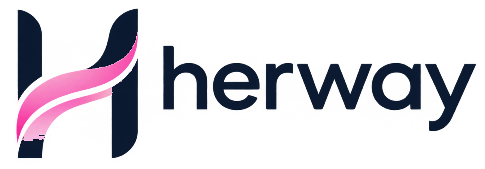

<p align="center">
  
</p>

<p align="center">
  <strong>O caminho dela no mercado financeiro.</strong><br />
  Plataforma com IA que capacita, educa e conecta mulheres que querem entrar ou migrar para o mercado financeiro.
</p>

<p align="center">
  
  
  
  
  
  
</p>

<p align="center">
  <a href="#-sobre-o-projeto">Sobre</a> ·
  <a href="#-a-jornada-em-5-etapas">Jornada</a> ·
  <a href="#-funcionalidades">Funcionalidades</a> ·
  <a href="#-tecnologias">Tecnologias</a> ·
  <a href="#-como-rodar-localmente">Como rodar</a> ·
  <a href="#-autoras">Autoras</a>
</p>

---

## 💗 Sobre o projeto

A **Her Way** nasceu no **Galapagos Capital Challenge** com uma missão clara: aumentar a presença feminina no mercado financeiro. A plataforma guia cada mulher por uma jornada estruturada e gamificada, das primeiras noções de finanças até a vaga, em áreas como **Asset Management, Investment Banking, Crédito e Research**.

São duas trilhas, definidas por um diagnóstico inicial:

| Trilha | Para quem | Foco |
|---|---|---|
| **Primeiros Passos** (Trilha A) | Universitárias e iniciantes | Estágios, programas de férias e ligas de mercado |
| **Novos Horizontes** (Trilha B) | Mulheres em transição de carreira | Competências transferíveis e vagas de transição |

> **Modelo de negócio B2B2C:** a plataforma é **100% gratuita para as mulheres** e se sustenta com empresas parceiras, que acessam talentos de forma ética e com privacidade de dados (LGPD).

> 🔗 **Acesse a plataforma:** _adicione aqui o link de produção da Vercel_

## 🧭 A jornada em 5 etapas

| Etapa | O que acontece |
|---|---|
| **1. Inscrição e diagnóstico** | Cadastro, envio de currículo em PDF e questionário que define a trilha |
| **2. Formação básica** | Cursos, conceitos técnicos, áreas do mercado, soft skills e quizzes com XP |
| **3. Mentoria e networking** | Match com mentoras do mercado, agenda de mentorias, eventos e comunidade |
| **4. Preparação para processos** | Currículo, LinkedIn, cases e simulação de entrevistas |
| **5. Conclusão e oportunidades** | Plano de carreira e Mural de Vagas com vagas reais de finanças |

## ✨ Funcionalidades

**Para as alunas**
- 🏠 **Dashboard:** hero da jornada, nível e XP, mentora recomendada, vagas compatíveis, próximo evento e competências
- 📈 **Giro de Mercado:** CDI, Selic, Ibovespa e dólar em tempo real (AwesomeAPI)
- 🎓 **Cursos e Quizzes:** catálogo com materiais em PDF/PowerPoint, vídeos e quizzes com respostas comentadas
- 🏅 **Gamificação:** XP, 5 níveis (Exploradora → Protagonista), conquistas e avatar em pixel art personalizável
- 👩‍💼 **Mentoria:** match por afinidade e agendamento de sessões de 30 minutos (horário de Brasília)
- 💬 **Conexões:** conversas 1:1 e grupos privados, com moderação por denúncia
- 💼 **Mural de Vagas:** vagas de finanças de fontes brasileiras, com link direto para a candidatura oficial
- 🤖 **Mentora Virtual:** assistente com IA que traduz o "economês" e orienta a carreira 24/7

**Para a gestão (Painel Admin)**
- 📊 **Painel de Impacto:** KPIs da jornada, do diagnóstico à empregabilidade
- 🗂️ **Gerenciar conteúdos:** importação do catálogo de cursos e upload de materiais
- ✅ **Curadoria:** aprovação de mentoras, sincronização de vagas e moderação das conexões

## 🛠 Tecnologias

| Camada | Tecnologia |
|---|---|
| Front-end | [Next.js 15](https://nextjs.org/) (App Router), React 19, TypeScript, Tailwind CSS 4, Lucide Icons |
| Back-end e dados | [Supabase](https://supabase.com/): PostgreSQL, Auth, Storage e Row Level Security |
| Inteligência artificial | Google Gemini (Mentora Virtual), com motor de regras local quando não há chave |
| Integrações | AwesomeAPI (cotações), Empregare, Lever, Adzuna, Jooble, Himalayas e Jobicy (vagas) |
| Deploy | [Vercel](https://vercel.com/), com Vercel Cron para sincronizar vagas diariamente |

## 🚀 Como rodar localmente

**Pré-requisitos:** Node.js 20 ou superior e npm.

```bash
git clone https://github.com/Callejonjon/Projeto_Her_Way.git
cd Projeto_Her_Way
npm install
cp .env.example .env.local   # preencha as chaves (opcional)
npm run dev                  # http://localhost:3000
```

> 💡 **Modo demonstração:** sem as chaves do Supabase, a plataforma roda com dados de exemplo. Isso é ideal para apresentar ou testar o visual.

### Variáveis de ambiente

| Variável | Uso | Obrigatória |
|---|---|---|
| `NEXT_PUBLIC_SUPABASE_URL` | URL do projeto Supabase | Para usar o banco real |
| `NEXT_PUBLIC_SUPABASE_ANON_KEY` | Chave pública (anon) do Supabase | Para usar o banco real |
| `SUPABASE_SERVICE_ROLE_KEY` | Gravação de vagas pelo servidor. **Nunca exponha no front** | Para a sincronização automática |
| `CRON_SECRET` | Protege a rota `/api/jobs/sync` chamada pelo Vercel Cron | Recomendada em produção |
| `GEMINI_API_KEY` | Respostas da Mentora Virtual com IA | Opcional |
| `ADZUNA_APP_ID` / `ADZUNA_APP_KEY` | Fonte de vagas Adzuna Brasil | Opcional |
| `JOOBLE_BR_API_KEY` | Fonte de vagas Jooble Brasil | Opcional |
| `HIMALAYAS_API_KEY` | Fonte de vagas Himalayas | Opcional |

### Banco de dados (Supabase)

Execute os scripts no **SQL Editor** do Supabase, começando por `supabase_schema.sql`. Os demais scripts são migrações aditivas, uma por funcionalidade:

| Script | Funcionalidade |
|---|---|
| `supabase_schema.sql` | Estrutura base: perfis, progresso, mentorias, vagas e view de KPIs |
| `supabase_learning_catalog.sql` → `supabase_learning_media.sql` | Catálogo de cursos e materiais (executar nessa ordem) |
| `supabase_mentor_photos.sql`, `supabase_mentor_automatic_approval.sql` | Fotos de perfil e aprovação de mentoras |
| `supabase_mentor_booking.sql` → `supabase_mentor_booking_fixes.sql` | Agenda de mentorias (executar nessa ordem) |
| `supabase_community_chat.sql`, `supabase_network_conexoes.sql` | Comunidade e Conexões |
| `supabase_avatar_foundation.sql` → `supabase_avatar_initialize.sql` → `supabase_avatar_visual_assets.sql` | Avatares em pixel art (executar nessa ordem) |

## 📁 Estrutura do projeto

```
src/
├── app/            # Rotas (App Router): dashboard, jornada, cursos, mentoria, vagas, conexões, perfil, admin…
│   └── api/        # Rotas de servidor: Mentora Virtual (chat) e sincronização de vagas
├── components/     # Componentes de UI: dashboard, avatar, admin, AppShell…
└── lib/            # Regras de negócio (XP, trilhas, match), store, Supabase e provedores de vagas
docs/               # Documentação técnica e identidade visual (docs/assets)
supabase_*.sql      # Scripts e migrações do banco
```

### Documentação complementar

- [`HERWAY_VAGAS_BR.md`](HERWAY_VAGAS_BR.md): integração com fontes de vagas do Brasil
- [`HERWAY_IMPORTACAO.md`](HERWAY_IMPORTACAO.md): importação do catálogo de cursos
- [`HERWAY_AVATAR_GUIDE.md`](HERWAY_AVATAR_GUIDE.md): cursos abertos, materiais e professoras-IA
- [`docs/avatar-v2-production.md`](docs/avatar-v2-production.md): contrato de produção dos avatares

## 👩‍💻 Autoras

<!-- Preencha com o nome, o papel e o link do LinkedIn de cada autora. Remova as linhas que não forem usadas. -->

| Autora | Papel no projeto | LinkedIn |
|---|---|---|
| **Nome Sobrenome** | Ex.: Product & UX | [](https://www.linkedin.com/in/seu-perfil) |
| **Nome Sobrenome** | Ex.: Desenvolvimento Front-end | [](https://www.linkedin.com/in/seu-perfil) |
| **Nome Sobrenome** | Ex.: Dados e Back-end | [](https://www.linkedin.com/in/seu-perfil) |
| **Nome Sobrenome** | Ex.: Conteúdo e Negócios | [](https://www.linkedin.com/in/seu-perfil) |
| **Nome Sobrenome** | Ex.: Pesquisa e Estratégia | [](https://www.linkedin.com/in/seu-perfil) |

## 🙌 Agradecimentos

À **Galapagos Capital** pelo desafio, e a todas as mulheres que já abriram caminho no mercado financeiro e inspiram as próximas.

<p align="center">
  <picture>
    <source media="(prefers-color-scheme: dark)" srcset="docs/assets/herway-logo.png" />
    
  </picture><br />
  <sub>Feito com 💗 pelo Grupo 4 · Galapagos Capital Challenge</sub>
</p>
